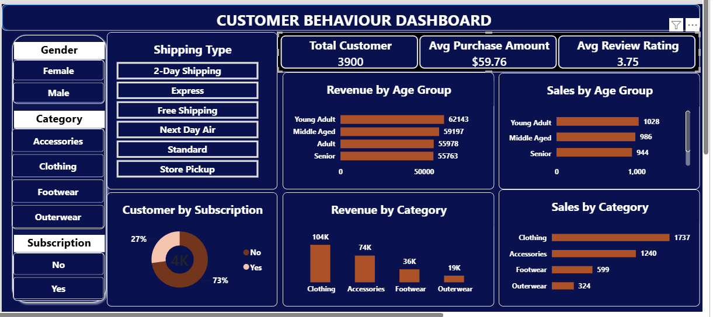

# 🛍️ Customer Shopping Behaviour Analysis

### An End-to-End Data Analytics Project Using Python, SQL Server & Power BI


---

## 📌 1. Project Overview

This project focuses on analyzing customer shopping behaviour to identify meaningful patterns in customer spending, purchasing preferences, product performance, discount usage, and subscription behaviour.

The project uses a dataset containing **3,900 customer purchase records** and applies an end-to-end data analytics approach using Python, SQL Server, and Power BI.

The main objective is to transform raw transactional data into actionable business insights that can help businesses understand their customers, improve customer retention, optimize marketing strategies, and support data-driven decision-making.

Rather than simply visualizing data, this project focuses on answering practical business questions through data exploration, SQL analysis, and interactive dashboard development.

## 🎯 2. Business Objectives

The key objectives of this project are:

- Analyze customer purchasing patterns and spending behaviour.
- Identify top-performing and highly rated products.
- Understand the relationship between discounts and purchasing behaviour.
- Compare subscribers and non-subscribers.
- Segment customers based on their purchase history.
- Analyze revenue contribution across different age groups and genders.
- Evaluate purchasing behaviour across different shipping methods.
- Develop actionable business recommendations from analytical findings.

## 📂 3. Dataset Description

The dataset contains **3,900 records and 18 columns** representing customer demographics, transaction information, product preferences, and shopping behaviour.

### Dataset Categories

| Category | Attributes |
|---|---|
| Customer Demographics | Customer ID, Age, Gender, Location |
| Purchase Details | Item Purchased, Category, Purchase Amount |
| Product Information | Size, Colour, Season |
| Customer Behaviour | Previous Purchases, Frequency of Purchases |
| Marketing Information | Discount Applied, Promo Code Used |
| Customer Experience | Review Rating, Shipping Type |
| Subscription | Subscription Status |

**Data Quality Issue:**
- Identified 37 missing values in the Review Rating column.
- Handled missing values during the Python data-cleaning process.

## 🛠️ 4. Tools & Technologies

| Technology | Application |
|---|---|
| Python | Data cleaning, preprocessing and exploratory analysis |
| Pandas | Data manipulation and transformation |
| Jupyter Notebook | Python analysis and documentation |
| SQL Server Express | Business analysis and SQL querying |
| Power BI | Interactive dashboard and visualization |
| CSV | Dataset storage and database integration |

## 🔄 5. Project Workflow

The project follows an end-to-end data analytics workflow:

**Raw Dataset → Python Data Cleaning → Feature Engineering → SQL Server Analysis → Power BI Dashboard → Business Recommendations**

### Step 1: Data Exploration and Cleaning Using Python

Used Python and Pandas to understand the dataset structure and prepare the data for analysis.

**Exploratory Data Analysis:**
- Loaded the dataset using Pandas.
- Examined data structure using `df.info()`.
- Generated descriptive statistics using `df.describe()`.
- Checked missing values and explored numerical distributions.

**Data Cleaning:**
- Identified 37 missing values in the Review Rating column.
- Imputed missing ratings using the median rating of the corresponding product category.
- Standardized column names using snake_case.
- Checked redundancy between `discount_applied` and `promo_code_used`.
- Removed the redundant `promo_code_used` column.

**Feature Engineering:**
- Created an `age_group` column by categorizing customer ages.
- Created a `purchase_frequency_days` feature from purchase data.

**Database Integration:**

Exported the cleaned dataset into CSV format and imported it into SQL Server Express for further analysis.

📁 Python Notebook: `eda_analysis.ipynb`

📁 Cleaned Dataset: `cleaned_data.csv`

## 🗄️ 6. SQL Business Analysis

Used SQL Server to answer 10 important business questions and extract insights from customer transaction data.

### Business Questions Solved

| No. | Business Question | Analysis Performed |
|---|---|---|
| 1 | Revenue by Gender | Compared total revenue generated by male and female customers. |
| 2 | High-Spending Discount Users | Identified discount users spending above the average purchase amount. |
| 3 | Top 5 Products by Rating | Ranked products based on average customer ratings. |
| 4 | Shipping Type Comparison | Compared average purchase amounts for Standard and Express shipping. |
| 5 | Subscribers vs. Non-Subscribers | Compared customer count, average spending, and total revenue. |
| 6 | Discount-Dependent Products | Identified products with the highest percentage of discounted purchases. |
| 7 | Customer Segmentation | Classified customers into New, Returning, and Loyal segments. |
| 8 | Top 3 Products per Category | Identified the three most purchased products within each category. |
| 9 | Repeat Buyers & Subscriptions | Examined repeat buyers across subscription groups. |
| 10 | Revenue by Age Group | Calculated revenue contribution from different age groups. |

### SQL Concepts Applied

- SELECT, WHERE, GROUP BY, HAVING
- Aggregate Functions: SUM(), AVG(), COUNT()
- CASE WHEN Statements
- Subqueries
- Common Table Expressions (CTEs)
- JOIN Operations
- Window Functions
- DENSE_RANK() and ROW_NUMBER()
- Sorting and Filtering
- Percentage Calculations

📁 SQL File: `Problems and Queries.sql`

## 📊 7. Power BI Dashboard

Developed an interactive Power BI dashboard to present important customer shopping metrics and business insights.

### Key Performance Indicators (KPIs)

- Total Customers: 3,900
- Average Purchase Amount: $59.76
- Average Review Rating: 3.75

### Dashboard Visualizations

- Revenue by Age Group
- Sales by Age Group
- Customer Distribution by Subscription Status
- Revenue by Product Category
- Sales by Product Category

### Interactive Filters

- Gender
- Product Category
- Shipping Type
- Subscription Status

These filters allow users to explore customer behaviour from different business perspectives.

### Dashboard Preview



📁 Power BI File: `Customer Behaviour Dashboard.pbix`

🎥 Dashboard Walkthrough: `customer_behaviour.mp4`

## 📈 8. Key Analytical Findings

The following findings were identified from the analysis:

### 1. Revenue by Gender

- Male customers generated $157,890 in total revenue.
- Female customers generated $75,191 in total revenue.

Male customers contributed a higher share of the recorded revenue.

### 2. Subscription Analysis

- Total Subscribers: 1,053
- Total Non-Subscribers: 2,847
- Subscribers represented approximately 27% of the customer base.

This indicates an opportunity to explore strategies for increasing subscription adoption.

### 3. Customer Segmentation

| Customer Segment | Number of Customers |
|---|---:|
| Loyal | 3,116 |
| Returning | 701 |
| New | 83 |

The Loyal segment represented the largest customer group under the project's segmentation criteria.

### 4. Top 5 Products by Average Rating

| Product | Average Rating |
|---|---:|
| Gloves | 3.86 |
| Sandals | 3.84 |
| Boots | 3.82 |
| Hat | 3.80 |
| T-shirt | 3.78 |

### 5. Shipping Type Comparison

| Shipping Type | Average Purchase Amount |
|---|---:|
| Express | $60 |
| Standard | $58 |

Express shipping customers recorded a slightly higher average purchase amount.

### 6. Discount-Dependent Products

| Product | Discount Rate |
|---|---:|
| Hat | 50% |
| Coat | 49% |
| Sneakers | 49% |
| Sweater | 48% |
| Pants | 47% |

These products had the highest percentages of discounted purchases.

### 7. Revenue by Age Group

| Age Group | Total Revenue |
|---|---:|
| Young Adults | $62,143 |
| Middle Aged | $59,197 |
| Adults | $55,978 |
| Seniors | $55,763 |

Young Adults contributed the highest revenue among the analyzed age groups.

## 💡 9. Business Recommendations

Based on the analytical findings, the following recommendations can help businesses improve their customer shopping strategies.

**1. Increase Subscription Adoption**

Introduce exclusive subscription benefits, personalized offers, and loyalty incentives to encourage non-subscribers to subscribe.

**2. Strengthen Customer Retention**

Develop loyalty programs and reward repeat purchases to maintain customer engagement and encourage long-term relationships.

**3. Optimize Discount Strategies**

Review products with high discount dependency and evaluate whether discount campaigns are generating sustainable sales.

**4. Improve Product Marketing**

Promote highly rated and frequently purchased products through targeted marketing campaigns.

**5. Implement Targeted Marketing**

Focus marketing campaigns on high-revenue customer age groups and understand their product preferences.

**6. Evaluate Shipping Preferences**

Further investigate customer preferences for Express and Standard shipping to improve the overall shopping experience.

## 📁 10. Repository Structure

```text
customer_behaviour_project/
│
├── cleaned_data.csv
│
├── eda_analysis.ipynb
│
├── Problems and Queries.sql
│
├── Customer Behaviour Dashboard.pbix
│
├── customer_behaviour.png
│
├── customer_behaviour.mp4
│
├── Customer Shopping Behaviour Analysis.docx
│
├── customer_shopping_behavior_original_file.csv
│
└── README.md
```

*The original dataset filename and any additional presentation file should be adjusted to match the actual files in the repository.*

## 🚀 11. Skills Demonstrated

This project demonstrates practical experience in:

- Data Cleaning and Preprocessing
- Exploratory Data Analysis (EDA)
- Python Programming
- Pandas Data Manipulation
- Feature Engineering
- SQL Query Writing
- Business Analysis
- Customer Segmentation
- Data Visualization
- Power BI Dashboard Development
- Business Intelligence
- Analytical Thinking and Problem Solving

## 📝 12. Project Conclusion

This project demonstrates how raw customer transaction data can be transformed into meaningful business insights through a structured data analytics workflow.

By combining Python for data preparation, SQL Server for business analysis, and Power BI for interactive visualization, the project provides a comprehensive view of customer shopping behaviour.

The analysis highlights customer segments, revenue distribution, product performance, discount patterns, and subscription behaviour.

**The ultimate goal of data analytics is not just to analyze numbers, but to convert data into meaningful insights that support better business decisions.**

---

## 👨‍💻 Author

**Aspiring Data Analyst**

Skills: Python | SQL | Excel | Power BI | Data Analytics

Interested in transforming raw data into actionable business insights and solving real-world business problems.

⭐ If you find this project useful, feel free to explore the repository and share your feedback!
